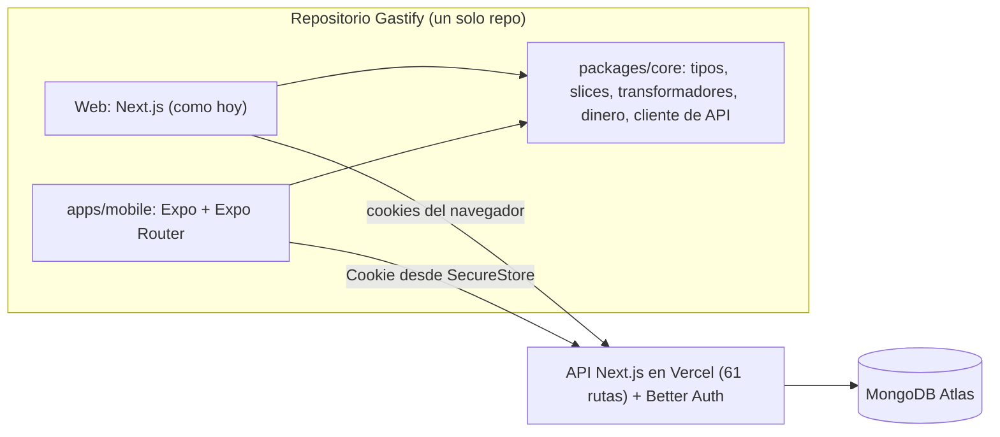

# Plan: Gastify para iPhone y Android con React Native (Expo)

> Fecha: 2026-10-15. Estado (2026-10-19): **fases 0, 1 y 2 hechas** (ver sección 11, al final); la fase 3 en adelante, propuesta.
> Base analizada: `main` en `f42231a` (Next.js 15.5, React 19, TypeScript, Redux Toolkit, Better Auth, MongoDB/Mongoose, Vercel).

## 1. Resumen

- **Qué se reutiliza tal cual:** el backend completo, es decir, las 61 rutas de `src/app/api` en Vercel y la base de datos. La app móvil será un cliente más de la misma API, como el navegador.
- **Qué se comparte entre web y móvil (unas 9,300 líneas):** los slices de Redux, los transformadores (`helpers/transformers`), dinero y monedas (`lib/money` sin `server/`), la ventana de historial (`lib/transactions/history*`), los hooks sin DOM, las reglas de step-up, el manifiesto y las equivalencias de íconos Fluent. Nada de eso usa `window`, `document` ni librerías web.
- **Qué hay que rehacer:** la interfaz, unas 29,000 líneas en 137 componentes. React Native no tiene HTML ni CSS: no sirven `antd` (68 archivos), MUI (6), Nivo (5), `react-toastify`, `@dnd-kit`, `next/navigation`/`next/link`/`next/image`, ni las ventanas hechas con `createPortal`. Es el grueso del trabajo.
- **Lo que ya sabes de React sí se transfiere:** componentes, hooks, props y estado, Redux, TypeScript, la forma de pensar la app. Cambian las piezas básicas: `<View>`/`<Text>` en vez de `
`/`
`, estilos sin cascada, navegación por pantallas apiladas, listas virtualizadas, y compilar y firmar apps.

## 2. Herramientas recomendadas

| Necesidad | Web hoy | Móvil | Por qué |
|---|---|---|---|
| Framework | Next.js | **Expo SDK 57** (React Native 0.86, React 19.2). El SDK 58 salió el 2026-10-15, pero la Expo Go de la App Store aún no lo soporta; se sube cuando salga | Es lo que la documentación de React Native recomienda. Evita tocar Xcode/Gradle a mano; compila en la nube (EAS) si hace falta |
| Rutas | App Router de Next | **Expo Router** | Rutas por archivos y `_layout` como en Next: la curva más corta para ti |
| Estilos | Tailwind | **NativeWind** (Tailwind para RN) | Mismas clases (`flex-row`, `gap-2`, `dark:`); se reusa el conocimiento y parte de la paleta |
| Estado | Redux Toolkit | **Redux Toolkit** (mismo código) | Los slices se comparten |
| Sesión | Better Auth (cookies) | **Better Auth + `@better-auth/expo`**, sesión en **`expo-secure-store`** (llavero de iOS / Keystore de Android) | Plugin oficial; las rutas de la API no cambian (`auth.api.getSession` lee la cookie que manda el cliente) |
| Listas largas (3,000+ movimientos) | DOM | **FlashList** (Shopify) | Virtualización: solo dibuja lo visible |
| Ventanas/modales | antd `Modal` | **`@gorhom/bottom-sheet`** + modales de Expo Router | Patrón nativo de hojas inferiores |
| Gráficas | Nivo | **Victory Native** (sobre **Skia**); círculos y treemap con `d3-hierarchy` + Skia | Nivo es solo web; Skia dibuja en GPU y es rápido |
| Íconos de categorías | `` WebP Fluent | **`expo-image`** con los mismos WebP | Se reusan los 1,285 emojis 3D y `iconLegacyMap.ts` |
| Íconos de interfaz | react-icons | **`@expo/vector-icons`** | Incluido en Expo |
| Fechas | MUI/antd DatePicker | `@react-native-community/datetimepicker` | Selector nativo de cada sistema |
| Avisos (toasts) | react-toastify | `sonner-native` o `burnt` | Avisos nativos |
| Animaciones | CSS / animate.css | `react-native-reanimated` | Corre en el hilo de UI |
| Archivos | antd `Upload` / descarga | `expo-document-picker`, `expo-file-system`, `expo-sharing` | Subir estados de cuenta y exportar con el menú "Compartir" |
| Face ID / huella | — | `expo-local-authentication` (bloqueo de la app) y passkeys nativas (fase 7) | |
| Caché local / modo sin conexión | — | `react-native-mmkv` (+ `redux-persist`) | Abrir la app al instante con los últimos datos |
| Pruebas | vitest | vitest (código compartido) + `jest-expo` / Testing Library (pantallas) + **Maestro** (flujos completos) | |

## 3. Arquitectura

- **Monorepo con workspaces de npm:** el Next actual se queda en la raíz al principio, para no tocar Vercel. Se agregan `apps/mobile` y `packages/core`. Mover la web a `apps/web` es opcional y va al final (requiere cambiar el "Root Directory" en Vercel).
- **`packages/core`** declara `react`, `react-redux` y `@reduxjs/toolkit` como *peerDependencies*, para que cada app use su propia copia (Expo fija React 19.2; la web usa 19.3). Hay que verificar con `npx expo-doctor` que no queden copias duplicadas de React.
- **Cliente de API compartido:** `fetcher.ts` pasa a recibir la URL base (en móvil, la de Vercel, o la IP de tu Mac en desarrollo) y una función que agrega encabezados (en móvil, `Cookie: authClient.getCookie()` con `credentials: "omit"`).

## 4. Cambios necesarios en el servidor (antes o junto con la app)

1. **[Seguridad, urgente, ya en producción] `accounts/get-account` no verifica la sesión.** Toma el correo del cuerpo de la petición y devuelve las cuentas de ese usuario (nombre, saldo, institución, moneda) a cualquiera que lo pida, sin iniciar sesión. Está marcada como pendiente en `.mds/api-security-audit-checklist.md`. Arreglo: `auth.api.getSession` y buscar al usuario por la sesión, igual que `get-transactions`. Es independiente de la app móvil y conviene hacerlo ya.
2. **Step-up de 2FA en la API.** Hoy la frescura de 15 minutos solo se revisa en `app/dashboard/layout.tsx` (las páginas), no en las rutas de la API; ya está anotado en `migration-ts-logs.md`. La app móvil no pasa por ese layout. Hay que crear un helper compartido (`requireSession(request, { stepUp: true })`) y usarlo en las rutas que leen o cambian datos. Esto también cierra el hueco para la web.
3. **Plugin `expo()` de Better Auth** y `trustedOrigins: ["gastify://"]`, más `exp://` solo en desarrollo.
4. **Sign in with Apple.** La regla 4.8 del App Store pide una opción equivalente cuando la app ofrece inicio de sesión con Google. Better Auth lo soporta; requiere la cuenta de Apple Developer.
5. **Passkeys nativas:** archivos `/.well-known/apple-app-site-association` y `/.well-known/assetlinks.json` servidos desde el dominio, para que iOS y Android acepten las passkeys del mismo dominio que la web. Conviene un dominio propio antes de publicar: las passkeys quedan ligadas al dominio.
6. **Peso de la respuesta de movimientos (4.85 MB) en datos móviles:** Vercel ya la comprime en producción. Más adelante convendría una sincronización incremental ("dame lo que cambió desde X"), pensando en caché local y modo sin conexión.
7. **Limpieza:** varios thunks mandan el correo en el cuerpo (`fetchAccounts(mail)`, etc.), aunque la API ya usa la sesión. En el cliente compartido se deja de mandar.

## 5. Mapa de pantallas (web → móvil)

Barra inferior: **Inicio · Movimientos · (+) · Presupuestos · Más**, parecida a la barra móvil actual del `Navbar`.

| Web | Móvil | Notas |
|---|---|---|
| `/login`, `/register`, `/verify-2fa` | Pila `(auth)`: login, registro, código 2FA | Correo y contraseña, Google, Apple; código TOTP / de respaldo |
| `/dashboard` | Inicio | Resumen, pestañas de ingresos y gastos, top 3, presupuesto; los widgets de abajo se montan al hacer scroll (ya pensado así) |
| `/dashboard/movements` | Movimientos | FlashList, filtros en hoja inferior, edición múltiple con selección por pulsación larga |
| Botón (+) / `AddTransactionModal` | Hoja "Agregar" | El flujo más usado: tiene que quedar en 2 o 3 toques |
| `/dashboard/budgets` | Presupuestos | Barras y comparativos con Victory Native |
| `/dashboard/accounts` | Más → Cuentas | Reordenar con arrastre (`react-native-reorderable-list` o similar) |
| `/dashboard/categories` | Más → Categorías | Árbol, selector de íconos Fluent con buscador; circle packing y treemap con Skia |
| `/dashboard/history` | Más → Historial | Gráficas comparativas |
| `/dashboard/projections` | Más → Proyecciones | Tabla con scroll horizontal |
| `/dashboard/profile` | Más → Perfil | Moneda, 2FA, passkeys, tokens de API, borrar cuenta (Apple exige que se pueda borrar desde la app: ya existe) |
| Herramientas (`ToolsFab`: categorizador, duplicados, subir archivo) | Más → Herramientas | Subida con selector de documentos |

## 6. Fases

Las duraciones son estimaciones gruesas para una persona trabajando con ayuda de IA.

| Fase | Contenido | Termina cuando… | Estimado |
|---|---|---|---|
| **0. Preparación** | Instalar herramientas (sección 7). Arreglar `get-account`. Helper de sesión con step-up en la API | La app vacía de Expo abre en el simulador de iOS, en el emulador de Android y en tu iPhone; la API ya no responde sin sesión | 2–4 días |
| **1. Código compartido** | Workspaces de npm; mover a `packages/core` los tipos, slices, transformadores, dinero, historial e íconos; cliente de API configurable. La web importa desde ahí | La web compila (`next build`), pasan vitest, tsc y eslint, y producción se ve igual | ~1 semana |
| **2. Esqueleto móvil** | Expo Router con barra inferior, NativeWind, tema claro/oscuro, tipografías, íconos Fluent con `expo-image`, store de Redux | Navegas entre pantallas vacías con el diseño de Gastify | 3–5 días |
| **3. Sesión y seguridad** | Login con correo, código 2FA, step-up, Google, Apple, sesión en SecureStore, bloqueo con Face ID al volver a la app, cerrar sesión | Entras con una cuenta desechable y la sesión sobrevive al cerrar la app; tras 15 min pide verificación | 1–1.5 semanas |
| **4. MVP de lectura** | Inicio, Movimientos (carga por fases como en la web), Cuentas, Presupuestos | Ves tus números iguales a la web (comparación automática con la misma cuenta) | 2–3 semanas |
| **5. Escritura** | Agregar, editar y borrar movimientos; transferencias; edición múltiple; categorías y subcategorías con selector de íconos; cuentas | Todo lo diario se puede hacer sin la web | 2–3 semanas |
| **6. Análisis** | Historial, Proyecciones, circle packing y treemap, comparativos de presupuestos | Paridad de gráficas con la web | 2–3 semanas |
| **7. Funciones nativas** | Passkeys nativas (Face ID como step-up real), subir estado de cuenta (PDF/XLSX), exportar con "Compartir", voz a texto que llama a `speech-add`, caché local; opcional: notificaciones y widget de iOS | — | 2–4 semanas |
| **8. Publicación** | Cuentas de Apple Developer (99 USD/año) y Google Play (25 USD, pago único); EAS Build y Submit; TestFlight y prueba interna de Play; ícono, splash, aviso de privacidad, etiquetas de privacidad / "Data safety" | La app está en TestFlight y en prueba interna, y después en las tiendas | 1–2 semanas + revisión |

Total: unos 3–4 meses hasta tener la app en las tiendas. Un MVP útil (fases 0–4 y "agregar movimiento" de la 5) toma unas 6–8 semanas.

## 7. Herramientas que faltan en tu Mac (revisado el 2026-10-15)

Tienes Homebrew, Node 26.5 y npm 11. **No tienes Xcode** (solo las Command Line Tools), **ni Android Studio, JDK, Watchman ni CocoaPods.** 36 GB de RAM y 620 GB libres alcanzan de sobra.

1. **Xcode** desde la App Store (unos 15–20 GB con el simulador). Luego, en Terminal:
   - `sudo xcode-select -s /Applications/Xcode.app/Contents/Developer`
   - `sudo xcodebuild -license accept`
   - Abrir Xcode una vez e instalar la plataforma iOS (Settings → Components).
2. `brew install watchman cocoapods`
3. **JDK 17** (el que recomienda Expo para Android): `brew install --cask zulu@17` (pide tu contraseña).
4. **Android Studio**: `brew install --cask android-studio`. En el asistente instalar Android SDK, Platform-Tools, Emulator y una imagen de sistema (arm64). Luego agregar a `~/.zshrc`:
   - `export ANDROID_HOME=$HOME/Library/Android/sdk`
   - `export PATH=$PATH:$ANDROID_HOME/emulator:$ANDROID_HOME/platform-tools`
5. **Cuenta de Expo** (gratis) y `npm i -g eas-cli`.
6. **Expo Go** en tu iPhone para las primeras pruebas; después, un "development build" propio.
7. **Node:** Node 26 entra a LTS este mes, así que debería funcionar; si `npx expo-doctor` se queja, usar Node 24 LTS con `nvm`.

**Desarrollo diario:** `npx expo start`, luego `i` (simulador de iOS) o `a` (emulador de Android). Contra el servidor local, el simulador de iOS ve `localhost:3000`, el emulador de Android usa `10.0.2.2:3000` y el iPhone físico usa la IP de la Mac en tu red. Se siguen usando cuentas desechables, nunca la tuya real.

## 8. Riesgos

| Riesgo | Cómo se cubre |
|---|---|
| Dos versiones de React en el monorepo | Ya no aplica: Expo SDK 58 usa React 19.3.0, la misma versión que la web. De todos modos `packages/core` no depende de React |
| Passkeys nativas y dominio `*.vercel.app` | Dominio propio antes de publicar; mientras tanto, TOTP como step-up |
| Pedir el código 2FA cada 15 minutos en el teléfono es molesto | Passkey con Face ID como prueba real; decidir si móvil tiene otra ventana de tiempo (decisión de seguridad tuya) |
| Revisión de Apple para una app de finanzas | Aviso de privacidad, borrar cuenta desde la app (ya existe), Sign in with Apple, etiquetas de privacidad completas |
| Romper la web al mover código a `packages/core` | Fase 1 sola, sin pantallas móviles; `next build` + vitest + revisión en Chrome antes de seguir |
| Desfase entre web y móvil cuando cambie la API | Tipos de respuesta en `packages/core` (ya existen como `*Response` en cada ruta) y, a futuro, esquemas `zod` compartidos |

## 9. Decisiones pendientes

1. ¿Arreglamos ya `get-account` (fuga de datos sin sesión en producción)?
2. ¿Monorepo en este mismo repo (recomendado) o repo aparte para móvil?
3. ¿El MVP empieza con iOS y Android a la vez (Expo lo permite casi sin costo extra) o solo iOS?
4. ¿Ventana de step-up en móvil: la misma de 15 minutos o una distinta con Face ID?
5. ¿Dominio propio antes de publicar (necesario para passkeys bien hechas)?

## 10. ¿React Native deja de tener soporte? ¿Hay mejor ruta? (investigado el 2026-10-15)

**No hay anuncio de que React Native se descontinúe.** Lo que sí encontré:
- Sigue publicando versiones: 0.82 (oct 2025, primera que corre solo con la Nueva Arquitectura), 0.84 (feb 2026, Hermes V1 por defecto), 0.85 (abr), 0.86 (jun) y **0.87 (11 ago 2026)**. Fuente: blog oficial de React Native.
- En oct 2025 Meta cedió React y React Native a la **React Foundation**, bajo la Linux Foundation; entre los miembros fundadores están Amazon, Callstack, Expo, Meta, Microsoft, Software Mansion y Vercel. Meta sigue contribuyendo, pero deja de ser la única dueña. Es lo contrario de "se acaba el soporte".
- Lo que tal vez escuchaste: sí se eliminó el soporte de la **arquitectura antigua** (0.82–0.84) y se están retirando APIs sueltas (por ejemplo `SafeAreaView`). Eso rompió apps viejas, pero no es el fin del framework. Para una app nueva no afecta.
- Riesgo real, aunque especulativo: la prioridad futura de Meta. La fundación existe justamente para reducirlo.

**Comparación para Gastify** (una persona, TypeScript, ya hay API y Redux):

| Opción | Reusa | Ventajas | Desventajas |
|---|---|---|---|
| **React Native + Expo** (recomendada) | API, Redux, lógica (~9,300 líneas), TypeScript, tus conocimientos de React | Interfaz realmente nativa, mayor ecosistema, EAS compila y publica sin Xcode a mano | Hay que rehacer la interfaz |
| **Flutter** | Solo la API | Gráficas y animaciones muy consistentes | Dart: lenguaje nuevo, no se comparte nada de código con la web, ecosistema más chico |
| **Kotlin Multiplatform / Compose** | Solo la API | Muy buena para equipos Kotlin/nativos | Dos lenguajes nuevos (Kotlin y, para iOS, Swift/Compose), justo lo que quieres evitar |
| **PWA o Capacitor** (envolver la web actual) | **Toda la interfaz web** | Lo más barato y rápido: días, no meses | Se siente menos nativa; Apple puede rechazar apps que son "una página web empaquetada" (guía 4.2); passkeys, Face ID y modo sin conexión salen peor |

**Recomendación:** React Native con Expo es la mejor ruta para tu caso. Si quieres algo en tu teléfono ya, una PWA (agregar a la pantalla de inicio) cuesta casi nada y se puede hacer en paralelo, pero no sustituye una app nativa para las tiendas.

Fuentes: blog de React Native (reactnative.dev/blog), anuncios de la React Foundation (opensourceforu.com, linuxiac.com), comparativas 2026 de terceros (de calidad variable; los porcentajes de adopción son orientativos), notas de Capacitor 8 (Ionic) y guías sobre la regla 4.2 de Apple.

## 11. Estado real (2026-10-19)

**Versiones:** Expo SDK **57** (React Native 0.86.3, React 19.2.3 en la app; la web sigue en React 19.3). El SDK 58 salió el 2026-10-15, pero la Expo Go de la App Store todavía no lo soporta (Expo dice "en unas semanas"). Cuando salga, se sube con `npx expo install expo@^58` y `npx expo install --fix`.

**Repositorio:** monorepo con npm workspaces (`apps/mobile`, `packages/core`), ya en `main` (`2f88942`). El trabajo de las fases 1 y 2 está en la rama `mobile-phase-1-2` (**sin fusionar a `main`**).

**Herramientas en tu Mac:** `watchman`, `cocoapods`, `openjdk@17`, Android SDK por línea de comandos y el emulador `gastify_pixel` (variables en `~/.zshrc`). Para probar en el iPhone basta Expo Go (App Store del iPhone) y la misma red Wi-Fi; no hace falta Xcode. Xcode solo sirve para el simulador de iPhone y para compilar en local.

**Fase 0 (preparación): hecha.** Herramientas, `get-account` con sesión, 2FA reciente en la API, ids propios al editar movimientos.

**Fase 1 (código compartido): hecha.** `packages/core` tiene: dinero, formato, fechas/periodos, orden, ventana de historial, los slices de Redux y el reductor raíz, los transformadores, los datos de íconos Fluent, el cliente de API (`configureApi`, `lazyApi`) y los ganchos de rendimiento (`configurePerf`). La web los re-exporta desde `src` (sus imports no cambian) y los configura en `src/lib/store.ts`; la app móvil los configura en `apps/mobile/src/store.ts`. El paquete compila en modo estricto.

**Fase 2 (esqueleto móvil): hecha, con dos recortes.**
- Hecho: Expo Router con barra inferior flotante (Inicio, Movimientos, Agregar, Presupuestos, Más), íconos de las mismas familias que usa la web (FaWallet, FaMoneyBillTransfer, MdSavings, IoAdd) vía `@expo/vector-icons`, botón "+" con el degradado morado de la web (`expo-linear-gradient`), paleta de Gastify en claro y oscuro (los tokens `--gf-*`), tienda de Redux y pantallas base. Metro fuerza una sola copia de React (la de la app).
- Recortado: **NativeWind** (estilos con `StyleSheet` por ahora), tipografías propias, y **íconos Fluent con `expo-image`** (los datos ya están en core; falta dibujarlos en pantalla, se hace con las listas de la fase 4).
- Verificado en el emulador de Android (claro y oscuro, navegación entre pestañas). **iOS: falta confirmarlo en el iPhone**; el paquete de iPhone se genera sin errores y usa los mismos componentes.

**Cómo probar:** `npm run mobile` en la raíz y escanear el QR con la Cámara del iPhone (Expo Go). Android: `emulator -avd gastify_pixel` y abrir la dirección `exp://IP:8081` que imprime Expo.

**Pendiente menor:** borrar `apps/mobile/src/app/explore.tsx` y los archivos de plantilla que solo usa (`hint-row`, `external-link`, `ui/collapsible`); hoy `explore` está oculto de la barra. En desarrollo sale un aviso rojo de React ("state update on a component that hasn't mounted yet") que viene del núcleo de Expo Router (`ExpoRoot`), no del código de Gastify.

**Siguiente (fase 3, inicio de sesión):** requiere cambios en el servidor (plugin `expo()` de Better Auth y `trustedOrigins`), cliente de Better Auth con SecureStore, pantalla de login con correo y código 2FA, y decidir la ventana de verificación en el teléfono. Es la parte más delicada; conviene hacerla con el modelo más capaz y probarla con cuentas desechables.
